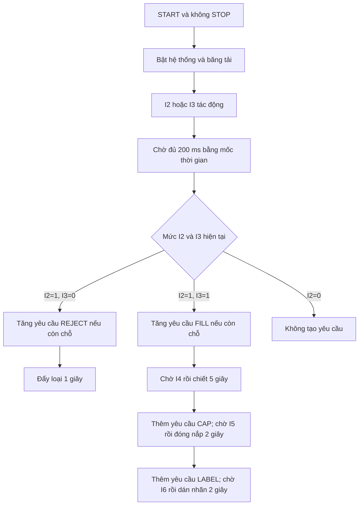
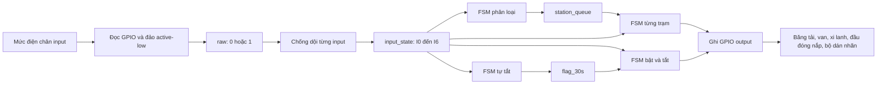
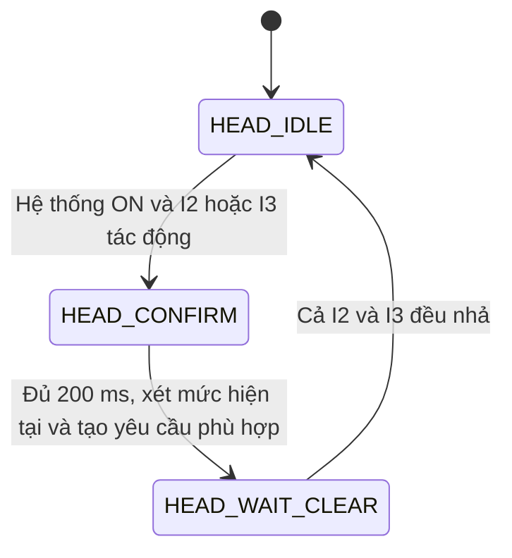

# Giải thích hoạt động của chương trình điều khiển dây chuyền chai

Tài liệu giải thích [src/main.c](src/main.c), đối chiếu phần ánh xạ chân trong [src/gpio.c](src/gpio.c), giao diện trong [include/gpio.h](include/gpio.h) và cấu hình [platformio.ini](platformio.ini). Nội dung mô tả hành vi của mã nguồn hiện tại, không phải kết quả chạy thử trên phần cứng.

## 1. Tổng quan: chương trình làm gì?

Chương trình điều khiển một dây chuyền gồm băng tải, bộ phân loại chai và bốn trạm: loại chai, chiết rót, đóng nắp, dán nhãn. Phần cứng đích là Arduino Uno dùng ATmega328P, với tần số CPU dự kiến 16 MHz.

Quy trình chính:

1. Nhấn START khi STOP không tác động: bật hệ thống và băng tải.
2. Khi I2 hoặc I3 phát hiện chai, chờ 200 ms rồi đọc trạng thái hiện tại của hai cảm biến để phân loại.
3. Nếu cả I2 và I3 tác động, tạo một yêu cầu chiết rót. Nếu chỉ I2 tác động, tạo một yêu cầu loại chai.
4. Chai được chấp nhận đi qua chiết rót → đóng nắp → dán nhãn. Mỗi trạm sau cần cả yêu cầu đang chờ và cảm biến vị trí tác động mới bắt đầu.
5. Nhấn STOP hoặc không có tín hiệu ở cả I2 và I3 trong 30 giây liên tục: tắt toàn bộ output, hủy chu trình và xóa yêu cầu chờ.

Băng tải được bật suốt khi hệ thống ON; code không tắt băng tải mỗi khi chiết hoặc đóng nắp. Việc giữ chai tại hai trạm này dùng output chặn chai riêng.



## 2. Kiến trúc: vì sao không cần delay?

FSM (Finite State Machine — máy trạng thái hữu hạn) lưu công việc đang ở bước nào. Mỗi lần được gọi, FSM kiểm tra điều kiện, có thể đổi trạng thái rồi trả về ngay.

Ví dụ trạm chiết không bật van rồi đứng chờ 5 giây. Nó bật van, lưu thời điểm bắt đầu, chuyển sang `DOING`. Những vòng lặp sau chỉ kiểm tra đã đủ 5 giây chưa. Trong thời gian đó, chương trình vẫn đọc STOP, phân loại chai khác và cập nhật các trạm còn lại.

Có bốn nhóm xử lý:

| Nhóm | Trách nhiệm |
|---|---|
| FSM tổng | Bật/tắt hệ thống và băng tải |
| FSM đầu vào | Xác nhận và phân loại theo I2/I3 |
| FSM tự tắt | Theo dõi khoảng thời gian I2/I3 cùng không tác động |
| FSM trạm | Bốn bản trạng thái độc lập cho REJECT, FILL, CAP, LABEL |

CPU chạy tuần tự từng hàm, không có bốn luồng xử lý thực sự. Các cơ cấu có thể hoạt động đồng thời vì mức output được phần cứng giữ nguyên giữa các lần cập nhật. Ngắt Timer1 chỉ cung cấp đồng hồ thời gian.

## 3. Các tín hiệu vào và ra

### 3.1. Input

| Tín hiệu | Chân Uno | Chân AVR | Vai trò |
|---|---|---|---|
| I0 | D2 | PD2 | START |
| I1 | D3 | PD3 | STOP |
| I2 | D4 | PD4 | Cảm biến chai dưới; cũng dùng để chờ nhả ở trạm loại |
| I3 | D5 | PD5 | Cảm biến chai trên |
| I4 | D6 | PD6 | Vị trí chiết rót |
| I5 | D7 | PD7 | Vị trí đóng nắp |
| I6 | D8 | PB0 | Vị trí dán nhãn |

Input có điện trở kéo lên nội (pull-up). Cực tính tín hiệu là active-low:

| Mức điện ở chân | Giá trị sau hàm đọc GPIO | Ý nghĩa logic |
|---|---|---|
| HIGH | 0 | Không tác động |
| LOW | 1 | Đang tác động |

Các FSM dùng giá trị đã chống dội trong `input_state[]`, không dùng trực tiếp mức điện trên chân. Vì vậy `I2 == 1` nghĩa là cảm biến I2 đang tác động ổn định theo bộ lọc, dù chân điện đang LOW.

### 3.2. Output

| Tên output | Chân Uno | Chân AVR | Khi bật |
|---|---|---|---|
| CONVEYOR | A1 | PC1 | Chạy băng tải |
| FILL_VALVE | A0 | PC0 | Bật van chiết |
| FILL_STOPPER | D13 | PB5 | Chặn chai ở trạm chiết |
| CAP_HEAD | D12 | PB4 | Bật đầu đóng nắp |
| CAP_STOPPER | D11 | PB3 | Chặn chai ở trạm đóng nắp |
| LABELER | D10 | PB2 | Bật bộ dán nhãn |
| REJECT_PUSHER | D9 | PB1 | Bật xi lanh loại chai |
| CHECK_I2_I3 | A2 | PC2 | LED báo đã tiếp nhận yêu cầu chiết |

Output là active-high: ghi `active = 1` tạo mức HIGH, ghi `0` tạo mức LOW. A0–A2 ở đây được dùng làm chân số, không dùng ADC.

## 4. Luồng dữ liệu đi như thế nào?

### 4.1. Từ cảm biến đến cơ cấu



Luồng chính là **tín hiệu điện → trạng thái logic ổn định → quyết định FSM → số yêu cầu chờ → trạng thái trạm → mức output**. Không có giao tiếp mạng hay truyền thông giữa các trạm trong code này; dữ liệu đi qua các biến dùng chung trong RAM.

### 4.2. Luồng thời gian

```text
Timer1 tạo ngắt mỗi 1 ms
    → ISR tăng system_millis
    → millis_now() đọc nguyên vẹn bộ đếm
    → biến now của một vòng lặp
    → chống dội, xác nhận 200 ms, tự tắt 30 s, định thời từng trạm
```

Tất cả FSM trong một lượt dùng cùng một ảnh chụp `now`. Không có việc mỗi trạm tự tăng một bộ đếm theo số vòng lặp.

### 4.3. Luồng yêu cầu giữa các trạm

```text
Phân loại đạt → queue[FILL]++
FILL bắt đầu → queue[FILL]--
FILL hoàn tất → queue[CAP]++
CAP bắt đầu → queue[CAP]--
CAP hoàn tất → queue[LABEL]++
LABEL bắt đầu → queue[LABEL]--
LABEL hoàn tất → kết thúc, không tạo yêu cầu tiếp

Phân loại chỉ I2 → queue[REJECT]++
REJECT bắt đầu → queue[REJECT]--
REJECT hoàn tất → kết thúc, không chuyển sang FILL
```

Tên `queue` ở đây chỉ một **bộ đếm yêu cầu**, không phải danh sách lưu từng chai. Code không lưu ID, thời điểm đến hay vị trí của mỗi chai. Cảm biến vị trí quyết định lúc nào một yêu cầu được thực hiện; việc ghép đúng yêu cầu với đúng chai phụ thuộc thứ tự di chuyển thực tế trên dây chuyền.

## 5. Dữ liệu và hằng số quan trọng

| Thành phần | Giá trị/kiểu | Ý nghĩa |
|---|---|---|
| `AUTO_OFF_TIME_MS` | 30000 | Thời gian vắng tín hiệu I2/I3 để tự tắt |
| `HEAD_CONFIRM_MS` | 200 | Thời gian chờ trước khi quyết định phân loại |
| `DEBOUNCE_MS` | 2 | Số mẫu liên tiếp khác trạng thái cũ để đổi input |
| `INPUT_COUNT` | 7 | Số input được lọc |
| `system_millis` | `volatile uint32_t` | Đồng hồ do ngắt cập nhật |
| `main_state` | `main_state_t` | OFF hoặc ON |
| `head_state` | `head_state_t` | Trạng thái phân loại |
| `timer_state` | `timer_state_t` | Trạng thái tự tắt |
| `head_started_at` | `uint32_t` | Mốc bắt đầu chờ xác nhận chai |
| `timer_started_at` | `uint32_t` | Mốc bắt đầu khoảng vắng chai |
| `flag_30s` | `uint8_t` | Cờ truyền yêu cầu tự tắt sang FSM tổng |
| `station_state[]` | Mảng enum | Trạng thái riêng từng trạm |
| `station_queue[]` | Mảng `uint8_t` | Số yêu cầu đang chờ, tối đa 255 mỗi trạm |
| `station_started_at[]` | Mảng `uint32_t` | Mốc bật cơ cấu của từng trạm |
| `duration[]` | `{1000, 5000, 2000, 2000}` | Thời gian REJECT, FILL, CAP, LABEL, tính bằng ms |
| `input_state[]` | Mảng `uint8_t` | Trạng thái input đã lọc |
| `input_counter[]` | Mảng `uint8_t` | Số mẫu liên tiếp khác trạng thái hiện tại |
| `last_sample_ms` | `uint32_t` | Tick đã lấy mẫu gần nhất |

Chỉ số trạm có thứ tự `REJECT=0`, `FILL=1`, `CAP=2`, `LABEL=3`, `STATION_COUNT=4`. Ba mảng của trạm dùng chung chỉ số: phần tử cùng vị trí luôn mô tả cùng một trạm. Phép chuyển yêu cầu `i + 1` chỉ dùng sau FILL và CAP nên thứ tự này có ý nghĩa.

Biến `static` ở phạm vi file tồn tại suốt thời gian chương trình chạy và chỉ truy cập trực tiếp trong file đó. Những biến không gán giá trị ban đầu được khởi tạo bằng 0: các trạm bắt đầu ở `IDLE`, hàng chờ rỗng, input logic ban đầu bằng 0.

`I0_START`, `I1_STOP`, `I2`, `I3`, `I4` là macro truy cập phần tử của `input_state[]`. `SYS_ON` là biểu thức kiểm tra `main_state == MAIN_SYS_ON`, không phải một biến trạng thái riêng.

## 6. Khởi động và thứ tự vòng lặp chính

### 6.1. Khởi động

`main()` gọi `hardware_setup()` một lần, theo thứ tự:

1. `gpio_init()`: cấu hình input với pull-up, output ở LOW.
2. `outputs_off()`: ghi tắt đầy đủ tám output.
3. `timer1_init()`: cấu hình Timer1 và nguồn ngắt so sánh A.
4. `sei()`: cho phép ngắt toàn cục.

Sau đó hệ thống vẫn OFF và chờ START. Dự án khai báo framework Arduino, nhưng mã ứng dụng tự cung cấp `main()` và dùng thanh ghi AVR; luồng đang mô tả không dùng `setup()`, `loop()` hay `millis()` của Arduino.

### 6.2. Một lượt xử lý

```text
while (1)
  1. now = millis_now()
  2. inputs_update(now)
  3. timer_fsm(now)
  4. main_fsm()
  5. head_fsm(now)
  6. Nếu I4 tác động: tắt LED A2
  7. stations_update(now)
  → lặp lại ngay
```

Thứ tự này quyết định hành vi:

- Input được cập nhật trước khi các FSM kiểm tra điều kiện.
- Timer chạy trước FSM tổng, nên cờ hết 30 giây được xử lý ngay trong cùng lượt.
- FSM tổng chạy trước phân loại và các trạm, nên STOP đã được chống dội sẽ tắt/reset chúng trước khi cập nhật tiếp.
- Phân loại chạy trước các trạm, nên yêu cầu mới có thể được trạm nhận ngay trong lượt đó nếu trạm đang IDLE và đủ điều kiện.
- Khi vừa START, timer đã chạy trong trạng thái OFF ở đầu lượt; việc bắt đầu đếm vắng chai diễn ra từ lượt tiếp theo.

## 7. Giải thích chi tiết từng phần

### 7.1. Đồng hồ: `timer1_init()`, ISR và `millis_now()`

Timer1 chạy ở chế độ CTC: đếm đến giá trị so sánh rồi bắt đầu chu kỳ mới. Với CPU 16 MHz và prescaler 64:

```text
Tần số timer = 16.000.000 / 64 = 250.000 Hz
OCR1A       = 16.000.000 / 64 / 1000 - 1 = 249
Chu kỳ      = (249 + 1) / 250.000 = 0,001 giây = 1 ms
```

`TCCR1A = 0` xóa cấu hình cũ của thanh ghi này; `WGM12` chọn CTC; `TCNT1 = 0` đặt bộ đếm về 0. Ghi 1 vào `OCF1A` trong `TIFR1` xóa cờ so sánh cũ, `OCIE1A` cho phép ngắt so sánh A, còn `CS11 | CS10` chọn chia 64 để timer chạy.

ISR `TIMER1_COMPA_vect` chỉ tăng `system_millis`, không xử lý cảm biến hay trạm. Bộ đếm 32 bit quay về 0 sau khoảng 49,7 ngày.

`volatile` buộc trình biên dịch thực hiện truy cập biến có thể bị ngắt thay đổi. Tuy nhiên AVR là CPU 8 bit nên đọc 32 bit cần nhiều thao tác. `millis_now()` dùng `ATOMIC_BLOCK(ATOMIC_RESTORESTATE)` để ngắt không chen giữa lúc đọc bốn byte, sau đó khôi phục trạng thái ngắt trước đó.

Các khoảng chờ dùng phép tính:

```c
(uint32_t)(now - started_at) >= duration
```

Đây là kiểm tra thời gian đã qua. Phép trừ số không dấu vẫn dùng được qua thời điểm bộ đếm quay vòng, miễn thời gian thực cần phân biệt chưa vượt một chu kỳ đầy đủ của bộ đếm. Thời điểm đổi output là lần vòng lặp kiểm tra thấy đủ hạn, nên có thể trễ thêm một khoảng xử lý vòng lặp.

### 7.2. Chống dội: `inputs_update(now)`

Nếu `now == last_sample_ms`, hàm trả về để tránh đếm nhiều mẫu trong cùng một tick. Nếu là tick mới, hàm đọc lần lượt bảy input:

1. Nếu `raw` giống trạng thái ổn định, xóa bộ đếm lệch.
2. Nếu khác, tăng bộ đếm lệch.
3. Nếu bộ đếm đạt 2, cập nhật trạng thái ổn định bằng `raw`, rồi xóa bộ đếm.

Ví dụ với input đang ổn định ở 0:

| Lần lấy mẫu | `raw` | Kết quả |
|---|---|---|
| 1 | 1 | Đếm 1, trạng thái vẫn 0 |
| 2 | 0 | Xóa đếm, trạng thái vẫn 0 |
| 3 | 1 | Đếm 1, trạng thái vẫn 0 |
| 4 | 1 | Đủ 2 mẫu, trạng thái chuyển thành 1 |

Cùng một thuật toán áp dụng cả khi tác động và khi nhả, kể cả START/STOP. STOP vì thế được xử lý sau bộ lọc chứ không phải ngắt trực tiếp từ chân.

**Điểm cần đối chiếu:** chú thích trong mã ghi “20 mẫu/20 ms”, nhưng hằng số thực tế là `2U`. Hành vi hiện tại là **2 mẫu liên tiếp**. Với nhịp lấy mẫu đều mỗi ms, độ trễ nằm cỡ 1–2 ms tùy lúc tín hiệu đổi; nếu vòng lặp chậm thì lâu hơn. Hàm không lấy bù các tick đã bỏ qua.

### 7.3. Thêm yêu cầu: `queue_push()`

Hàm nhận con trỏ tới một bộ đếm. Ví dụ `queue_push(&station_queue[FILL])` lấy địa chỉ bộ đếm chiết và tăng chính phần tử đó.

Nếu bộ đếm nhỏ hơn 255 thì tăng một; nếu đã bằng 255 thì giữ nguyên. Đây là cách bão hòa để tránh `uint8_t` tràn từ 255 về 0. Không có cờ báo lỗi khi yêu cầu bị bỏ vì đầy. Yêu cầu đang thực hiện đã được trừ khỏi queue nên queue chỉ đếm phần còn chờ.

### 7.4. Tắt hệ thống: `outputs_off()` và `system_off()`

`outputs_off()` duyệt các mã output liên tiếp từ 0 đến `GPIO_OUTPUT_CHECK_I2_I3`, ghi tất cả về 0. Hàm này chỉ xử lý đầu ra.

`system_off()` thực hiện thêm việc hủy trạng thái vận hành:

- Đưa FSM tổng về OFF và FSM phân loại về HEAD_IDLE.
- Đưa timer về TM_RESET, xóa cờ 30 giây.
- Đưa cả bốn trạm về IDLE, xóa queue và mốc bắt đầu của từng trạm.

Đồng hồ ms và dữ liệu chống dội vẫn được giữ. Mốc thời gian đầu vào và timer không cần xóa vì được ghi lại trước lần đếm tiếp theo. Chu trình bị ngắt không được lưu để tiếp tục khi bật lại.

### 7.5. Bật/tắt tổng: `main_fsm()`

| Trạng thái hiện tại | Điều kiện | Xử lý |
|---|---|---|
| MAIN_SYS_OFF | START = 1 và STOP = 0 | Bật băng tải, chuyển ON |
| MAIN_SYS_OFF | Các trường hợp khác | Giữ OFF |
| MAIN_SYS_ON | STOP = 1 hoặc `flag_30s = 1` | Gọi `system_off()` |
| MAIN_SYS_ON | Không có yêu cầu dừng | Giữ ON |

STOP có ưu tiên so với START. Tuy nhiên chương trình kiểm tra **mức nút**, không bắt cạnh nhấn: giữ START rồi nhả STOP có thể làm hệ thống bật lại. Nếu giữ START lúc tự tắt vì 30 giây, hệ thống cũng có thể bật lại ở lượt xử lý sau.

### 7.6. Tự tắt: `timer_fsm(now)`

Nếu hệ thống OFF, hàm luôn đưa timer về TM_RESET, xóa cờ và trả về.

Khi hệ thống ON:

| Trạng thái | Điều kiện | Hành động và trạng thái tiếp |
|---|---|---|
| TM_RESET | I2 = 0 và I3 = 0 | Lưu `now`, chuyển TM_COUNTING |
| TM_RESET | Có I2 hoặc I3 | Chưa bắt đầu đếm |
| TM_COUNTING | I2 hoặc I3 tác động | Hủy lần đếm, về TM_RESET |
| TM_COUNTING | Vẫn vắng và đủ 30000 ms | Đặt cờ 30 giây, chuyển TM_TRIGGER |
| TM_TRIGGER | Chờ FSM tổng xử lý | Giữ cờ |

Timer đo một khoảng **vắng liên tục**, không cộng dồn nhiều khoảng vắng ngắn. Nó chỉ nhìn I2/I3, không kiểm tra queue, I4/I5/I6 hoặc việc các trạm đang chạy. Vì vậy tự tắt có thể hủy cả công việc còn ở phía sau dây chuyền.

### 7.7. Phân loại: `head_fsm(now)`

FSM có ba trạng thái:



Ở HEAD_IDLE, phát hiện tín hiệu sẽ lưu `head_started_at = now`. Ở HEAD_CONFIRM, khi đủ 200 ms, quyết định theo bảng:

| I2 | I3 | Quyết định |
|---|---|---|
| 0 | 0 | Không tạo yêu cầu |
| 0 | 1 | Không tạo yêu cầu |
| 1 | 0 | Tăng queue REJECT nếu chưa đầy |
| 1 | 1 | Tăng queue FILL nếu chưa đầy; ghi LED theo `!I4` |

Code không yêu cầu I2/I3 giữ nguyên liên tục suốt 200 ms và không ghi nhớ chúng đã từng tác động. Nó chỉ đọc trạng thái đã lọc ở lần kiểm tra đủ hạn. Nếu chai đi qua quá nhanh khiến I2 đã nhả lúc đó, sẽ không có yêu cầu nào được tạo.

Dù có tạo yêu cầu hay không, FSM vẫn chuyển HEAD_WAIT_CLEAR. Nó chỉ cho phép chu kỳ mới sau khi cả hai cảm biến nhả. Nếu các chai nối sát nhau mà không có khoảng cả I2/I3 cùng nhả được bộ lọc ghi nhận, chúng không được phân loại thành các chu kỳ riêng.

Khi FILL đầy, trường hợp cả I2 và I3 tác động bị bỏ qua; không tự chuyển chai đó sang REJECT.

### 7.8. Điều khiển cơ cấu: `station_output(index, active)`

Hàm gom các chân thuộc cùng trạm:

| Trạm | Output được ghi cùng giá trị |
|---|---|
| REJECT | Xi lanh loại |
| FILL | Van chiết và chặn chai chiết |
| CAP | Đầu đóng nắp và chặn chai đóng nắp |
| LABEL | Bộ dán nhãn |

Van và chặn chai được bật/tắt trong cùng lần gọi bằng các lệnh GPIO liên tiếp; không có thời gian chờ chặn chai ổn định trước khi mở van. Trạm đóng nắp cũng tương tự. Hàm này không điều khiển băng tải hoặc LED.

### 7.9. Vận hành trạm: `stations_update(now)`

Hàm duyệt REJECT → FILL → CAP → LABEL. Mỗi trạm dùng bộ state, queue và timestamp riêng.

| Trạm | Cảm biến dùng | Điều kiện vị trí để bắt đầu | Thời gian bật |
|---|---|---|---|
| REJECT | I2 | Không cần cảm biến tác động, chỉ cần yêu cầu | 1000 ms |
| FILL | I4 | I4 = 1 | 5000 ms |
| CAP | I5 | I5 = 1 | 2000 ms |
| LABEL | I6 | I6 = 1 | 2000 ms |

**IDLE — chờ việc:** Khi hệ thống ON, queue > 0 và thỏa điều kiện vị trí, trạm trừ một yêu cầu, bật cơ cấu, lưu `now` rồi chuyển DOING.

**DOING — đang chạy:** Khi đủ thời gian, trạm tắt cơ cấu. FILL thêm một yêu cầu cho CAP; CAP thêm một yêu cầu cho LABEL. Sau đó chuyển WAIT_CLEAR. Việc cảm biến nhả sớm không làm dừng cơ cấu trước hạn.

**WAIT_CLEAR — chờ nhả:** Khi cảm biến của trạm bằng 0, chuyển IDLE. Trạm không nhận yêu cầu mới ngay trong cùng case này; phải chờ lần gọi tiếp theo. Nếu cảm biến còn tác động, trạm tiếp tục chờ dù queue có việc.

```mermaid
stateDiagram-v2
    [*] --> IDLE
    IDLE --> DOING: ON, có yêu cầu và đủ điều kiện vị trí; bật cơ cấu
    DOING --> WAIT_CLEAR: Đủ thời gian; tắt cơ cấu, chuyển yêu cầu nếu cần
    WAIT_CLEAR --> IDLE: Cảm biến nhả
```



REJECT không dùng I2 làm điều kiện bắt đầu, nhưng vẫn dùng I2 để thoát WAIT_CLEAR. Đây là hai vai trò khác nhau, không phải trạm loại hoàn toàn bỏ qua cảm biến.

Vì CAP được duyệt sau FILL, CAP có thể nhận yêu cầu vừa được FILL tạo trong cùng lượt nếu CAP đang IDLE và I5 đã tác động. LABEL cũng tương tự sau CAP. Điều này không có nghĩa chai vừa rời trạm trước đã tới trạm sau: code chỉ biết bộ đếm và mức cảm biến, không theo dõi danh tính chai.

### 7.10. LED A2 hoạt động ra sao?

Khi tiếp nhận thành công một chai đạt vào queue FILL, chương trình ghi LED bằng `!I4`: bật nếu I4 chưa tác động, tắt nếu I4 đang tác động.

Trong mỗi vòng lặp, I4 tác động sẽ tắt LED. Nếu I4 chưa tác động thì LED giữ trạng thái trước đó, kể cả I2/I3 đã nhả. Tắt hệ thống cũng tắt LED.

LED không phản ánh trực tiếp biểu thức `I2 && I3` ở mọi thời điểm và cũng không biểu diễn số yêu cầu chờ. Ví dụ queue FILL còn nhiều yêu cầu nhưng một chai kích I4 thì LED vẫn bị tắt.

## 8. Ví dụ theo một chai đạt

Giả sử hệ thống đã ON, các trạm IDLE, hàng chờ rỗng và tín hiệu đáp ứng đúng thứ tự:

| Mốc | Sự kiện | Dữ liệu/đầu ra thay đổi |
|---|---|---|
| `t0` | I2/I3 được nhận là tác động | HEAD_CONFIRM, lưu mốc `t0` |
| `t0 + 200 ms` hoặc lần kiểm tra sau đó | I2 = I3 = 1 | Queue FILL từ 0 lên 1; LED bật nếu I4 = 0 |
| `t1` | Chai tới I4, trạm chiết IDLE | Queue FILL về 0; van và chặn chiết bật; LED tắt |
| `t1 + 5000 ms` hoặc lần kiểm tra sau đó | Chiết đủ hạn | Van/chặn tắt; queue CAP lên 1; FILL chờ I4 nhả |
| `t2` | Chai tới I5, trạm CAP IDLE | Queue CAP về 0; đầu đóng và chặn nắp bật |
| `t2 + 2000 ms` hoặc lần kiểm tra sau đó | Đóng nắp đủ hạn | Cơ cấu CAP tắt; queue LABEL lên 1; CAP chờ I5 nhả |
| `t3` | Chai tới I6, trạm LABEL IDLE | Queue LABEL về 0; bộ dán nhãn bật |
| `t3 + 2000 ms` hoặc lần kiểm tra sau đó | Dán nhãn đủ hạn | Bộ dán nhãn tắt; LABEL chờ I6 nhả |

`t1`, `t2`, `t3` phụ thuộc chuyển động thực tế, không được tính từ tốc độ băng tải trong chương trình. Tổng thời gian bật cơ cấu cho chai đạt là 9 giây, chưa tính xác nhận 200 ms, vận chuyển và thời gian chờ trạm. Nhiều chai có thể đang được xử lý ở các trạm khác nhau nên không thể lấy 9 giây làm chu kỳ toàn dây chuyền.

Với chai chỉ có I2 tác động tại thời điểm phân loại, queue REJECT tăng. Nếu trạm loại đang IDLE, xi lanh bật ngay trong lượt cập nhật trạm, giữ 1 giây, rồi tắt và chờ I2 nhả.

## 9. Lớp GPIO và các thao tác C/AVR cần hiểu

[src/gpio.c](src/gpio.c) tách thao tác thanh ghi khỏi logic điều khiển:

- `DDRx`: bit 0 cấu hình input, bit 1 cấu hình output.
- `PINx`: đọc mức điện thực tế của chân.
- `PORTx`: với output là mức xuất; với input là bật/tắt điện trở pull-up.
- `_BV(n)`: tạo mặt nạ `1 << n`.
- `register |= mask`: đặt các bit trong mặt nạ lên 1.
- `register &= ~mask`: xóa các bit trong mặt nạ về 0, giữ bit khác.

Khởi tạo input dùng PD2–PD7 và PB0. Khởi tạo output dùng PB1–PB5 và PC0–PC2. Latch output được ghi LOW trước khi đổi hướng chân sang output để bắt đầu ở mức tắt. Những bit ngoài nhóm chân được dùng được giữ nguyên bởi mặt nạ.

Hàm đọc GPIO chọn thanh ghi theo enum, lấy mức chân rồi đảo logic. Hàm ghi GPIO chọn chân theo enum và đặt/xóa bit. Mã enum input không hợp lệ được đọc thành 0; mã output không hợp lệ không gây thay đổi chân.

[include/gpio.h](include/gpio.h) cung cấp kiểu enum và khai báo hàm để hai file C dùng chung. Include guard tránh khai báo lặp. `stdint.h` cung cấp các kiểu có độ rộng xác định như `uint8_t`, `uint16_t`, `uint32_t`.

Trong [src/main.c](src/main.c), hậu tố `U` biểu thị hằng số unsigned và `UL` biểu thị unsigned long. `switch/case` chọn xử lý theo trạng thái; `break` kết thúc case nên đổi state không làm chương trình tự chạy tiếp case mới ngay. `&station_queue[i]` lấy địa chỉ phần tử, còn `*queue` truy cập giá trị ở địa chỉ đó.

## 10. Những hành vi cần nhớ khi đọc hoặc sửa code

| Điểm | Hành vi thực tế |
|---|---|
| Chống dội | 2 mẫu liên tiếp, dù chú thích đang nói 20 mẫu |
| Xác nhận chai | Xét mức hiện tại sau 200 ms, không đòi hỏi giữ ổn định cả khoảng 200 ms |
| Queue | Chỉ đếm yêu cầu chờ, không nhận dạng từng chai |
| Queue đầy | Bỏ yêu cầu mới, không báo lỗi; có thể xảy ra cả khi chuyển từ FILL sang CAP hoặc CAP sang LABEL |
| Chờ vị trí | Không có timeout nếu queue có việc nhưng cảm biến vị trí không tác động |
| Chờ nhả | Không có timeout nếu cảm biến giữ tác động ở WAIT_CLEAR |
| Cảm biến nhả giữa DOING | Cơ cấu vẫn chạy đến đủ thời gian, trừ khi hệ thống bị tắt |
| START | Dùng mức, nên giữ nút có thể gây bật lại sau dừng |
| Tự tắt | Chỉ nhìn I2/I3, có thể hủy việc ở trạm sau |
| Tắt rồi bật lại | Mất yêu cầu cũ và tiến độ đang chạy; không khôi phục chu trình |
| Timer1 | Do chương trình cấu hình riêng; thay đổi nó sẽ ảnh hưởng toàn bộ định thời |

Khi sửa thời gian, đối chiếu các hằng số và `duration[]`. Khi đổi chân, đối chiếu lớp GPIO và bảng nối dây. Khi thêm trạm hoặc đổi thứ tự enum, cần xem lại cả ba mảng trạm, bảng thời gian, ánh xạ cảm biến/output và logic chuyển queue bằng `i + 1`.
