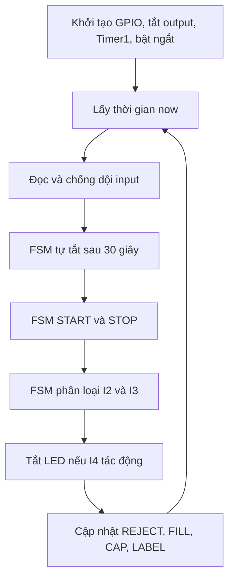

# Kịch bản thuyết trình source code điều khiển dây chuyền chai

Tài liệu được xây dựng từ [GIAI_THICH_CODE.md](GIAI_THICH_CODE.md), phục vụ trình bày trực tiếp khi mở [src/main.c](src/main.c). Các đoạn **Lời trình bày** có thể dùng làm lời nói; các đoạn **Chỉ vào code** hướng dẫn phần cần mở để minh họa.

Thời lượng gợi ý: 15–20 phút, chưa tính hỏi đáp. Nội dung đi theo thứ tự hiểu hệ thống rồi lần theo luồng thực thi, thay vì đọc lần lượt từng dòng từ đầu file. Các ví dụ là diễn giải theo mã nguồn, không phải kết quả đo trên phần cứng.

## 1. Mở đầu: bài toán chương trình giải quyết — khoảng 1 phút

**Lời trình bày:**

> Em xin trình bày chương trình điều khiển dây chuyền xử lý chai trên vi điều khiển ATmega328P, tương ứng với board Arduino Uno.
>
> Dây chuyền gồm băng tải, bộ phận kiểm tra chai và các cơ cấu loại chai, chiết rót, đóng nắp, dán nhãn. Khi người vận hành nhấn START, hệ thống bắt đầu chạy. Chai được kiểm tra bằng hai cảm biến I2 và I3. Tùy kết quả, chương trình tạo yêu cầu loại chai hoặc đưa chai vào quy trình chiết rót, đóng nắp và dán nhãn.
>
> Điểm chính của chương trình là sử dụng máy trạng thái và đồng hồ mili giây. Nhờ đó, trong lúc một trạm đang hoạt động, chương trình vẫn tiếp tục kiểm tra nút dừng và xử lý các trạm khác.
>
> Em sẽ trình bày theo ba bước: trước tiên là cấu trúc và tín hiệu của hệ thống, tiếp theo là luồng chạy từ khi khởi động, cuối cùng là theo dõi một chai đi qua toàn bộ quá trình.

**Sơ đồ nên chỉ khi nói:**

```text
                       ┌── Chỉ I2 ──→ Loại chai: 1 giây
START → Băng tải → Kiểm tra I2/I3 sau 200 ms
                       └── I2 và I3 → Chiết: 5 giây → Đóng nắp: 2 giây → Dán nhãn: 2 giây

STOP hoặc I2/I3 cùng vắng liên tục 30 giây → Tắt hệ thống, hủy công việc
```

**Câu chuyển:** “Để hiểu chương trình đưa ra các quyết định này như thế nào, trước hết em giới thiệu các tín hiệu vào, ra và cách chia source code.”

## 2. Cấu trúc source code và tín hiệu — khoảng 1 phút

**Chỉ vào code:** mở [src/main.c](src/main.c), [src/gpio.c](src/gpio.c) và [include/gpio.h](include/gpio.h).

**Lời trình bày:**

> Source được tách thành phần điều khiển và phần truy cập phần cứng. File chính chứa các máy trạng thái, hàng chờ và xử lý thời gian. Phần GPIO chịu trách nhiệm đọc hoặc ghi chân vi điều khiển. Header khai báo tên input, output và các hàm dùng chung.
>
> Cách tách này giúp phần điều khiển sử dụng tên như START, vị trí chiết hoặc van chiết, trong khi chi tiết chân nào thuộc port nào được đặt ở phần GPIO.

| Nhóm đầu vào | Tín hiệu | Vai trò |
|---|---|---|
| Người vận hành | I0, I1 | START, STOP |
| Phân loại | I2, I3 | Cảm biến chai dưới và trên |
| Vị trí trạm | I4, I5, I6 | Chiết rót, đóng nắp, dán nhãn |

> Input sử dụng pull-up và tác động ở mức điện thấp. Hàm đọc GPIO đảo mức này thành logic 1 để biểu thị đang tác động. Vì vậy, khi em nói I2 bằng 1 thì nghĩa là cảm biến đang tác động, không phải chân đang ở mức điện cao.
>
> Output dùng logic bật ở mức cao. Các output điều khiển băng tải, van, bộ chặn chai, đầu đóng nắp, bộ dán nhãn, xi lanh loại và LED báo.

**Câu chuyển:** “Sau khi xác định đầu vào và đầu ra, câu hỏi tiếp theo là chương trình tổ chức xử lý chúng bằng cách nào.”

## 3. Ý tưởng trung tâm: máy trạng thái và xử lý không chặn — khoảng 1,5 phút

**Chỉ vào code:** các enum trạng thái và ba mảng lưu thông tin trạm ở đầu [src/main.c](src/main.c).

**Lời trình bày:**

> Máy trạng thái, hay FSM, là cách mô tả một công việc bằng các bước hữu hạn. Mỗi lần được gọi, chương trình nhìn vào trạng thái hiện tại, kiểm tra điều kiện chuyển bước và thực hiện thao tác tương ứng.
>
> Chương trình có FSM bật/tắt tổng, FSM kiểm tra chai, FSM tự tắt và bốn FSM dành cho bốn trạm. Bốn trạm dùng cùng một dạng xử lý nhưng có dữ liệu riêng.
>
> Mỗi trạm cần nhớ ba thông tin: đang ở bước nào, còn bao nhiêu yêu cầu chờ và bắt đầu hoạt động lúc nào. Ba thông tin đó được lưu trong ba mảng có cùng chỉ số trạm.

| Dữ liệu | Cách giải thích khi nói |
|---|---|
| `station_state[i]` | Trạm i đang chờ, đang chạy hay chờ cảm biến nhả |
| `station_queue[i]` | Trạm i còn bao nhiêu yêu cầu chưa bắt đầu |
| `station_started_at[i]` | Trạm i bật cơ cấu tại thời điểm nào |

> Ví dụ khi chiết, chương trình bật van, ghi lại thời điểm và chuyển sang trạng thái đang làm. Nó trả về ngay để xử lý phần khác. Những lần gọi sau chỉ kiểm tra đã đủ 5 giây chưa, đủ rồi mới tắt van.
>
> CPU vẫn thực hiện các hàm tuần tự. Các cơ cấu hoạt động đồng thời được là vì chân output giữ nguyên mức đã ghi, còn mỗi trạm có trạng thái và mốc thời gian riêng. Đây không phải bốn luồng chương trình chạy song song.

**Câu chuyển:** “Với cách tổ chức đó, em bắt đầu lần theo chương trình từ hàm main.”

## 4. Từ lúc cấp nguồn đến vòng lặp chính — khoảng 1,5 phút

**Chỉ vào code:** phần `main()` và `hardware_setup()` trong [src/main.c](src/main.c).

**Lời trình bày:**

> Trong phần ứng dụng, main gọi hardware_setup một lần. Hàm này cấu hình GPIO, tắt tất cả output, thiết lập Timer1 rồi cho phép ngắt toàn cục. Ban đầu hệ thống ở trạng thái OFF, các hàng chờ bằng 0 và các trạm ở trạng thái IDLE.
>
> Sau khởi tạo, chương trình đi vào vòng lặp vô hạn. Mỗi vòng lấy một giá trị thời gian hiện tại, cập nhật input, kiểm tra tự tắt, xử lý bật/tắt hệ thống, phân loại chai, xử lý LED rồi cập nhật bốn trạm.



> Thứ tự này có chủ đích. Timer chạy trước FSM tổng để cờ hết 30 giây được xử lý ngay cùng lượt. FSM tổng chạy trước các trạm để khi nhận STOP đã qua lọc, nó tắt output và reset trạng thái trước khi các trạm được cập nhật.
>
> Cũng cần phân biệt: vòng lặp không có chu kỳ cố định 1 ms. Nó chạy liên tục; chỉ việc lấy mẫu input được giới hạn tối đa một lần cho mỗi giá trị tick thời gian.

**Câu chuyển:** “Để các bước như chờ 200 ms hay bật van 5 giây hoạt động chính xác theo thời gian, chương trình cần một đồng hồ chung.”

## 5. Đồng hồ thời gian và chống dội — khoảng 2 phút

### 5.1. Đồng hồ mili giây

**Chỉ vào code:** `timer1_init()`, ISR và `millis_now()` trong [src/main.c](src/main.c).

**Lời trình bày:**

> Timer1 được cấu hình để tạo ngắt mỗi 1 ms. Với CPU 16 MHz và bộ chia 64, timer nhận 250.000 nhịp mỗi giây. Giá trị so sánh 249 tương ứng 250 nhịp cho một chu kỳ, tức 1 ms.
>
> Mỗi lần ngắt, chương trình chỉ tăng biến system_millis. Phần quyết định điều khiển vẫn nằm trong vòng lặp chính để ngắt ngắn gọn.
>
> Hàm millis_now đọc bộ đếm trong vùng atomic, vì bộ đếm dài 32 bit còn vi điều khiển xử lý 8 bit. Nếu ngắt tăng bộ đếm giữa lúc đang đọc nhiều byte thì giá trị thu được có thể không nhất quán.

**Biểu thức cần giải thích:**

```c
(uint32_t)(now - station_started_at[i]) >= duration[i]
```

> Vế trái là thời gian đã trôi qua từ lúc bật trạm. Nếu lớn hơn hoặc bằng thời gian yêu cầu, trạm kết thúc. Chương trình chỉ kiểm tra điều kiện này rồi tiếp tục chạy, không đứng chờ tại đó.

### 5.2. Từ mức chân đến input ổn định

**Chỉ vào code:** `inputs_update()` trong [src/main.c](src/main.c).

**Lời trình bày:**

> Sau khi lấy thời gian, chương trình đọc các input và chống dội. Nếu mẫu mới giống trạng thái đang lưu, bộ đếm lệch được xóa. Nếu khác thì bộ đếm tăng; đủ số mẫu liên tiếp mới chấp nhận trạng thái mới.
>
> Trong phiên bản này hằng số chống dội là 2, nghĩa là hai mẫu liên tiếp, dù một số chú thích cũ ghi 20 mẫu. Đây là đếm mẫu, nên nếu vòng lặp chậm thì không thể khẳng định luôn đúng 2 ms.
>
> Kết quả được lưu vào input_state. Những phần sau đều dùng trạng thái đã lọc này, bao gồm cả START và STOP.

**Luồng cần nhớ:**

```text
Chân bị kéo LOW → Đọc GPIO thành logic 1 → Qua chống dội → input_state = 1 → FSM sử dụng
```

**Câu chuyển:** “Bây giờ đã có input ổn định và thời gian hiện tại, chương trình có thể xử lý yêu cầu bật hệ thống và nhận chai.”

## 6. Nhấn START và kiểm tra chai — khoảng 2 phút

### 6.1. Bật hệ thống

**Chỉ vào code:** `main_fsm()` trong [src/main.c](src/main.c).

**Lời trình bày:**

> Khi hệ thống OFF, nếu START tác động và STOP không tác động, chương trình bật băng tải và chuyển trạng thái sang ON. Nếu cả START và STOP cùng tác động thì không bật, nghĩa là STOP có ưu tiên.
>
> Băng tải tiếp tục chạy trong trạng thái ON. Việc giữ chai lúc chiết hoặc đóng nắp được thực hiện bằng các cơ cấu chặn riêng.

### 6.2. Phân loại đầu vào

**Chỉ vào code:** ba case trong `head_fsm()` ở [src/main.c](src/main.c).

**Lời trình bày:**

> FSM phân loại có ba bước. Đầu tiên là HEAD_IDLE, chờ hệ thống ON và có I2 hoặc I3 tác động. Khi có tín hiệu, nó lưu thời điểm và chuyển sang HEAD_CONFIRM.
>
> Ở bước xác nhận, sau khi đủ 200 ms, chương trình xét mức hiện tại của hai cảm biến. Nếu cả I2 và I3 bằng 1 thì tạo yêu cầu chiết. Nếu chỉ I2 bằng 1 thì tạo yêu cầu loại. Nếu I2 bằng 0 thì không tạo yêu cầu.
>
> Sau đó nó chuyển sang HEAD_WAIT_CLEAR, chờ cả hai cảm biến nhả rồi mới cho phép phân loại lần tiếp theo. Bước này tránh tạo lặp yêu cầu trong lúc một chai còn che cảm biến.

| I2 tại lúc xét | I3 tại lúc xét | Kết quả nếu queue tương ứng chưa đầy |
|---|---|---|
| 1 | 1 | Thêm yêu cầu FILL |
| 1 | 0 | Thêm yêu cầu REJECT |
| 0 | 0 hoặc 1 | Không tạo yêu cầu |

> Khoảng 200 ms là thời gian chờ trước khi xét, không phải yêu cầu cảm biến phải giữ nguyên suốt 200 ms. Chương trình không ghi nhớ những mức từng xuất hiện trong khoảng này.

**Câu chuyển:** “Kết quả phân loại chưa làm van chiết bật ngay. Nó được chuyển thành một yêu cầu chờ; trạm chỉ thực hiện khi chai tới đúng vị trí.”

## 7. Hàng chờ nối các trạm như thế nào? — khoảng 1 phút

**Chỉ vào code:** `station_queue[]`, `queue_push()` và phần chuyển yêu cầu trong [src/main.c](src/main.c).

**Lời trình bày:**

> Mỗi trạm có một bộ đếm yêu cầu chờ. Khi phân loại được chai đạt, bộ đếm FILL tăng một. Khi trạm chiết bắt đầu thực hiện, bộ đếm này giảm một. Khi chiết xong, chương trình tăng bộ đếm CAP. Đóng nắp xong thì tăng bộ đếm LABEL.
>
> Như vậy, dữ liệu chuyển giữa các trạm là số lượng công việc cần làm. Nó không lưu mã định danh hay vị trí từng chai. Cảm biến I4, I5 và I6 được dùng để xác nhận có chai tại trạm trước khi thực hiện yêu cầu.
>
> Bộ đếm dùng số nguyên 8 bit, tối đa 255. Hàm thêm yêu cầu giữ nguyên khi đầy để tránh tràn về 0; yêu cầu mới lúc đó bị bỏ.

```text
Phân loại đạt       Bắt đầu chiết       Chiết xong        Đóng nắp xong
queue[FILL]++  →    queue[FILL]--   →   queue[CAP]++  →   queue[LABEL]++
                                           ↓                  ↓
                                    Giảm khi CAP bắt đầu  Giảm khi LABEL bắt đầu
```

**Câu chuyển:** “Cả bốn trạm đều sử dụng cùng một quy tắc xử lý, nên em dùng trạm chiết để giải thích chi tiết.”

## 8. Đi sâu vào một trạm: IDLE → DOING → WAIT_CLEAR — khoảng 2 phút

**Chỉ vào code:** `stations_update()` và `station_output()` trong [src/main.c](src/main.c).

**Lời trình bày:**

> Hàm cập nhật trạm duyệt lần lượt REJECT, FILL, CAP và LABEL. Với mỗi trạm, nó chọn cảm biến tương ứng rồi xử lý theo trạng thái hiện tại.
>
> Với trạm chiết, ở trạng thái IDLE, cần đồng thời ba điều kiện: hệ thống ON, queue FILL có yêu cầu và cảm biến I4 tác động. Khi đủ, chương trình giảm queue một đơn vị, bật van cùng cơ cấu chặn, lưu thời điểm rồi chuyển sang DOING.
>
> Trong DOING, mỗi lần vòng lặp quay lại, chương trình kiểm tra thời gian đã trôi qua. Chưa đủ 5 giây thì giữ nguyên. Đủ 5 giây thì tắt van và chặn, thêm yêu cầu cho trạm đóng nắp, sau đó chuyển sang WAIT_CLEAR.
>
> Trong WAIT_CLEAR, trạm chờ I4 nhả mới trở về IDLE. Nếu hàng chờ vẫn còn yêu cầu, nó cũng không bắt đầu tiếp khi cảm biến chưa nhả. Việc nhận công việc tiếp theo diễn ra ở một lần cập nhật sau khi đã về IDLE.

```mermaid
stateDiagram-v2
    [*] --> IDLE
    IDLE --> DOING: ON, có yêu cầu, đủ điều kiện vị trí; bật cơ cấu và lưu thời gian
    DOING --> WAIT_CLEAR: Đủ thời gian; tắt cơ cấu và chuyển yêu cầu nếu có
    WAIT_CLEAR --> IDLE: Cảm biến nhả
```



**Bảng dùng để mở rộng từ trạm chiết sang các trạm khác:**

| Trạm | Điều kiện vị trí khi bắt đầu | Output bật | Thời gian | Sau khi xong |
|---|---|---|---|---|
| REJECT | Không yêu cầu cảm biến vị trí | Xi lanh loại | 1 giây | Chờ I2 nhả |
| FILL | I4 tác động | Van và chặn chiết | 5 giây | Thêm yêu cầu CAP, chờ I4 nhả |
| CAP | I5 tác động | Đầu đóng và chặn nắp | 2 giây | Thêm yêu cầu LABEL, chờ I5 nhả |
| LABEL | I6 tác động | Bộ dán nhãn | 2 giây | Chờ I6 nhả |

> Điểm riêng của trạm loại là có yêu cầu thì được bắt đầu ngay khi trạm IDLE và hệ thống ON; I2 chỉ được dùng để chờ nhả sau khi chạy xong.
>
> Trong DOING, cảm biến nhả sớm cũng không làm cơ cấu dừng trước hạn. Cơ cấu chỉ kết thúc khi đủ thời gian hoặc khi hệ thống bị tắt.

**Câu chuyển:** “Em ghép các phần vừa trình bày thành một ví dụ hoàn chỉnh để thấy cả luồng điều khiển và luồng dữ liệu.”

## 9. Theo dõi một chai từ đầu đến cuối — khoảng 2 phút

**Giả sử:** hệ thống đã ON, hàng chờ rỗng, các trạm IDLE, chai và cảm biến hoạt động đúng thứ tự. Các thời điểm dưới đây là ví dụ minh họa; trạng thái cảm biến được hiểu là đã qua chống dội.

| Thời điểm ví dụ | Sự kiện | Thay đổi chính |
|---|---|---|
| 1000 ms | I2/I3 tác động | Lưu mốc 1000, chuyển HEAD_CONFIRM |
| 1200 ms | Đủ 200 ms, I2/I3 vẫn cùng tác động | Queue FILL: 0 → 1; LED bật nếu I4 chưa tác động |
| 1500 ms | Chai tới I4 | Queue FILL: 1 → 0; bật van/chặn; lưu mốc 1500; LED tắt |
| 6500 ms | Đã chiết 5000 ms | Tắt van/chặn; queue CAP: 0 → 1; FILL chờ I4 nhả |
| 7000 ms | Chai tới I5 | Queue CAP: 1 → 0; bật đầu đóng/chặn; lưu mốc 7000 |
| 9000 ms | Đã đóng nắp 2000 ms | Tắt đầu đóng/chặn; queue LABEL: 0 → 1; CAP chờ I5 nhả |
| 9500 ms | Chai tới I6 | Queue LABEL: 1 → 0; bật dán nhãn; lưu mốc 9500 |
| 11500 ms | Đã dán nhãn 2000 ms | Tắt dán nhãn; LABEL chờ I6 nhả |

**Lời trình bày:**

> Ở ví dụ này, có thể thấy mỗi trạm chỉ bắt đầu sau hai sự kiện: đã có yêu cầu từ bước trước và cảm biến báo chai tới vị trí. Thời gian vận chuyển giữa các trạm do chuyển động thực tế quyết định, code không tính sẵn.
>
> Trong lúc chai thứ nhất đang được đóng nắp, trạm chiết có thể xử lý chai thứ hai nếu có yêu cầu, I4 tác động và trạm đã sẵn sàng. Vì vậy mỗi chai đi qua các bước theo thứ tự, nhưng các trạm có thể làm việc đồng thời với những chai khác nhau.
>
> Nếu ở thời điểm phân loại chỉ I2 tác động, luồng rẽ sang REJECT. Trạm loại bật xi lanh 1 giây rồi chờ I2 nhả, không tạo yêu cầu chiết tiếp theo.

**Chốt ý về dữ liệu:**

```text
Tín hiệu cảm biến
    → logic đã chống dội
    → FSM phân loại
    → bộ đếm yêu cầu
    → FSM trạm kết hợp cảm biến vị trí và thời gian
    → ghi output điều khiển cơ cấu
```

**Ghi chú cho người trình bày:** các mốc hết hạn được xử lý ở lần vòng lặp kiểm tra thấy đủ thời gian, có thể muộn hơn mốc lý tưởng một khoảng xử lý. Không gọi tổng 9 giây bật cơ cấu là thời gian đi hết dây chuyền hoặc chu kỳ sản xuất.

## 10. Khi STOP hoặc hết 30 giây thì luồng chạy thay đổi ra sao? — khoảng 1 phút

**Chỉ vào code:** `timer_fsm()`, `main_fsm()` và `system_off()` trong [src/main.c](src/main.c).

**Lời trình bày:**

> Ngoài luồng xử lý chai, mỗi vòng lặp đều kiểm tra điều kiện dừng. Nếu STOP được bộ lọc công nhận, FSM tổng gọi system_off. Hàm này tắt toàn bộ output, đưa các trạng thái về ban đầu và xóa hàng chờ.
>
> Cơ chế tự tắt cũng đi qua hàm đó. Khi cả I2 và I3 không tác động, timer bắt đầu đếm. Nếu một trong hai tác động trở lại thì hủy lần đếm. Nếu vắng liên tục đủ 30 giây, timer đặt cờ và FSM tổng xử lý dừng ngay trong cùng lượt.
>
> Tự tắt chỉ dựa vào hai cảm biến đầu vào, không xác nhận các trạm phía sau đã hết chai. Khi dừng, công việc đang chạy bị hủy; lần START tiếp theo không tiếp tục phần còn lại của chu trình cũ.

**Ví dụ nói thêm nếu cần:**

> Nếu van đang mở được 2 giây mà STOP được nhận, van bị tắt ở lượt xử lý đó. Chương trình không chờ đủ 5 giây và cũng không nhớ còn thiếu 3 giây để làm tiếp.

## 11. Kết thúc phần trình bày — khoảng 30 giây

**Lời trình bày:**

> Qua source code này, có ba điểm em muốn nhấn mạnh. Thứ nhất, input được chuẩn hóa và chống dội trước khi dùng để quyết định. Thứ hai, mỗi công đoạn có trạng thái, yêu cầu chờ và mốc thời gian riêng nên không cần dùng delay để chờ cơ cấu. Thứ ba, các công đoạn liên kết bằng bộ đếm yêu cầu, còn cảm biến vị trí quyết định thời điểm thực hiện.
>
> Nhờ cấu trúc đó, vòng lặp chính liên tục cập nhật toàn bộ hệ thống, vừa xử lý nhiều công đoạn vừa tiếp nhận điều kiện dừng. Đó là luồng hoạt động chính của chương trình em vừa trình bày.

## 12. Câu hỏi có thể gặp và cách trả lời

### Vì sao không dùng delay để giữ van 5 giây?

> Nếu chặn vòng lặp bằng delay thì các phần xử lý đặt trong vòng lặp cũng phải chờ. Ở đây em lưu mốc thời gian và kiểm tra lại ở các lượt sau, để vẫn đọc input và cập nhật các trạm khác trong lúc van đang mở.

### Chương trình có thực sự chạy song song không?

> CPU chạy lần lượt các hàm. Các output giữ mức trong thời gian giữa hai lần xử lý, và mỗi trạm có dữ liệu riêng, nên các cơ cấu có thể cùng hoạt động dù việc tính toán là tuần tự.

### Có cảm biến vị trí rồi, tại sao còn cần queue?

> Queue ghi nhận công việc đã được bước trước cho phép hoặc chuyển tới; cảm biến xác nhận có chai tại vị trí thực hiện. Nếu chỉ có cảm biến, trạm có thể xử lý cả chai chưa có yêu cầu hợp lệ từ bước trước.

### Queue có bảo đảm nhận dạng đúng từng chai không?

> Không. Nó chỉ lưu số yêu cầu. Việc ghép yêu cầu với chai dựa vào thứ tự di chuyển và cảm biến thực tế; source chưa có cơ chế theo dõi ID của từng chai.

### Vì sao phải chờ cảm biến nhả sau khi làm xong?

> Để trạm không nhận yêu cầu mới ngay khi chai cũ còn nằm tại cảm biến. Sau khi nhả, trạm mới quay lại trạng thái sẵn sàng.

### Nếu cảm biến vị trí không tác động hoặc bị giữ mãi thì sao?

> Nếu không tác động, yêu cầu tiếp tục chờ ở IDLE. Nếu giữ tác động sau khi xong, trạm chờ ở WAIT_CLEAR. Source chưa có timeout riêng cho hai tình huống này; điều kiện STOP và tự tắt tổng vẫn được kiểm tra.

### Vì sao vừa cần volatile vừa cần atomic?

> Volatile phục vụ truy cập biến có thể bị ngắt thay đổi; atomic bảo đảm việc đọc nhiều byte không bị ngắt chen giữa. Volatile tự nó không làm một lần đọc 32 bit trên AVR 8 bit trở thành nguyên vẹn.

### Đồng hồ tràn sau khoảng 49,7 ngày có làm định thời sai ngay không?

> Phép trừ unsigned giữa thời điểm hiện tại và mốc bắt đầu xử lý được trường hợp quay vòng, miễn khoảng thời gian thực cần phân biệt chưa vượt một vòng đầy đủ của bộ đếm. Các khoảng định thời ở đây ngắn hơn rất nhiều.

### Đủ 200 ms nghĩa là cả hai cảm biến đã ổn định suốt 200 ms?

> Không. Bộ lọc input và thời gian xác nhận là hai bước khác nhau. FSM chỉ chờ đủ 200 ms rồi xét mức đã lọc tại thời điểm đó.

### START có bắt cạnh nhấn không?

> Không, code kiểm tra mức sau chống dội. Vì thế giữ START rồi nhả STOP có thể làm hệ thống chạy lại; giữ START khi tự tắt cũng có thể dẫn đến bật lại ở lượt sau.

### LED A2 có sáng bất cứ lúc nào I2 và I3 cùng tác động không?

> Không. LED được ghi khi tiếp nhận thành công yêu cầu FILL: bật nếu I4 chưa tác động. I4 tác động hoặc tắt hệ thống sẽ tắt LED. LED không biểu diễn trực tiếp mức I2/I3 hay số chai đang chờ.

### Trạm sau có thể bắt đầu ngay trong lượt trạm trước kết thúc không?

> Có. Vòng duyệt đi từ FILL đến CAP rồi LABEL. Nếu trạm sau đang IDLE và cảm biến của nó đã tác động, nó có thể nhận yêu cầu vừa được thêm ngay trong lượt đó. Điều này không chứng minh đó là cùng một chai vừa di chuyển tới.

### Điểm nào của code hiện tại cần cải tiến?

> Có thể đồng bộ chú thích chống dội với giá trị 2 mẫu, bổ sung báo đầy queue, timeout chờ cảm biến và cơ chế START theo cạnh. Nếu cần tự tắt sau khi hoàn tất mọi công việc thì phải xem thêm trạng thái trạm và hàng chờ. Đây là hướng cải tiến, chưa phải hành vi đã có trong phiên bản hiện tại.

## 13. Tờ nhắc nhanh khi mở source để nói

| Thứ tự | Mở phần nào trong [src/main.c](src/main.c) | Ý chính cần nói |
|---|---|---|
| 1 | Enum và dữ liệu trạm | Mỗi trạm có state, queue, mốc thời gian riêng |
| 2 | `main()` | Khởi tạo một lần, sau đó quét liên tục |
| 3 | `hardware_setup()` | GPIO → tắt output → Timer1 → bật ngắt |
| 4 | Timer1, ISR, `millis_now()` | Đồng hồ 1 ms, ngắt chỉ tăng tick, đọc atomic |
| 5 | `inputs_update()` | Đảo logic ở GPIO, lọc 2 mẫu liên tiếp |
| 6 | `main_fsm()` | START bật, STOP ưu tiên |
| 7 | `head_fsm()` | Chờ 200 ms → phân loại → chờ cả hai nhả |
| 8 | `queue_push()` | Đếm yêu cầu chờ, bão hòa ở 255 |
| 9 | `stations_update()` | IDLE → DOING → WAIT_CLEAR |
| 10 | `station_output()` | Ánh xạ một trạm tới các output của nó |
| 11 | `timer_fsm()` và `system_off()` | Vắng đầu vào 30 giây hoặc STOP → tắt và xóa việc |

**Câu xương sống để nhớ cả bài:** “Đọc cảm biến, lọc tín hiệu, cập nhật trạng thái, tạo yêu cầu, chờ đúng vị trí, bật cơ cấu theo thời gian và chuyển yêu cầu sang công đoạn tiếp theo.”
